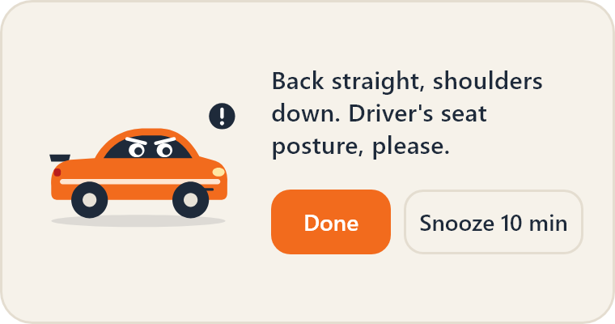
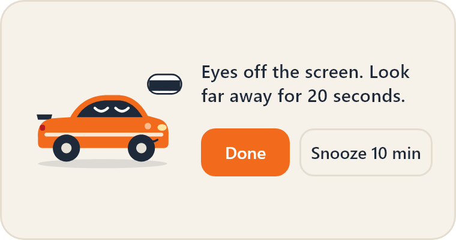
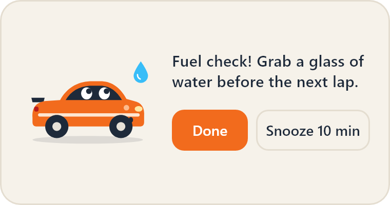
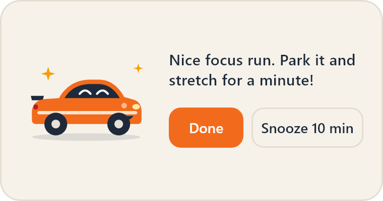
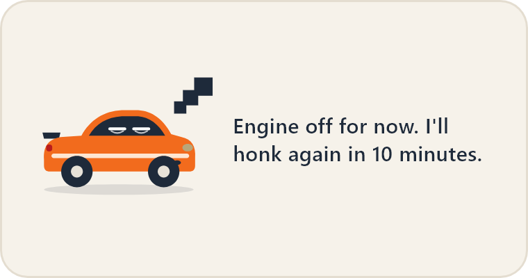
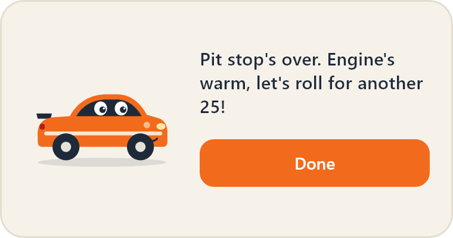
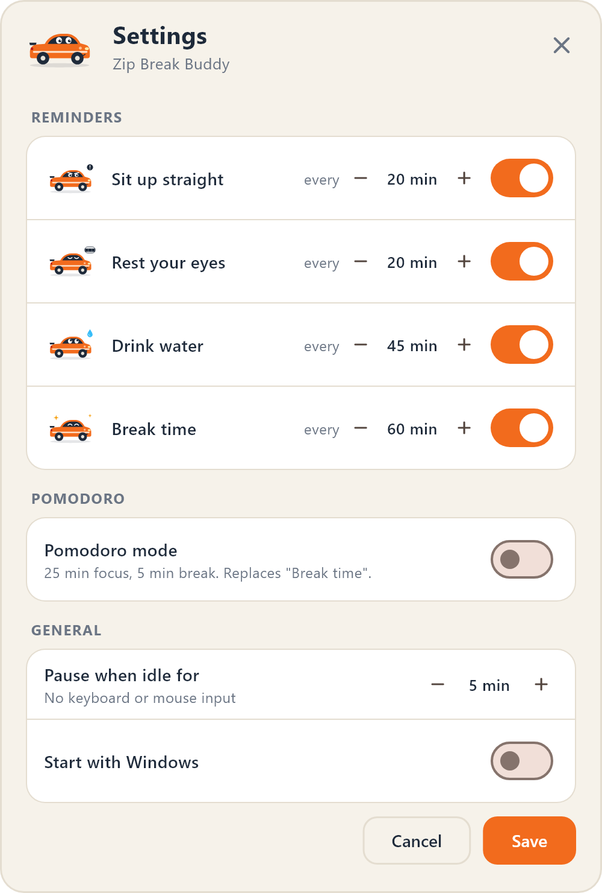

# Zip Break Buddy

A small Windows tray app that looks after you while you work. **Zip**, a friendly orange sports coupe, slides in from the corner of your screen to remind you to sit up straight, rest your eyes, drink water and take breaks. Then Zip gets out of the way.

<p align="center">
  
</p>

No webcam and no tracking: every reminder runs on a timer, and Zip pauses on its own when you step away from the PC.

## Features

- **Runs in the system tray.** No taskbar window during normal use. The tray menu has *Pause for 1 hour*, *Settings* and *Quit*.
- **Four reminders**, each with its own pose and an interval you can change:

  | Reminder | Default | Message |
  |---|---|---|
  | Sit up straight | every 20 min | "Back straight, shoulders down. Driver's seat posture, please." |
  | Rest your eyes | every 20 min, 10 min after posture | "Eyes off the screen. Look far away for 20 seconds." |
  | Drink water | every 45 min | "Fuel check! Grab a glass of water before the next lap." |
  | Break time | every 60 min | "Nice focus run. Park it and stretch for a minute!" |

- **A pop-up that stays out of the way.** It's a 380×200 frameless, always-on-top card that slides in at the bottom right. It doesn't take keyboard focus, so it never interrupts your typing, and it hides itself after 30 seconds if you ignore it.
- **Done or Snooze 10 min.** Snoozing shows a sleepy Zip for a moment, then brings that reminder back in 10 minutes.
- **One pop-up at a time.** Reminders that fire together wait in a queue, and the same reminder is never queued twice.
- **Idle detection.** Timers pause when you're away and restart fresh when you come back (see [below](#how-idle-detection-works)).
- **Pomodoro mode.** 25 minutes of focus, then a 5-minute break. Zip cheers you into the break and calls you back afterwards. In this mode the cycle replaces the regular *Break time* reminder, and the other reminders hold during the break.
- **Start with Windows**, via a per-user startup entry.
- **Settings are remembered** (shared_preferences). If a saved settings file is malformed, the app falls back to the defaults instead of breaking.
- **Only one copy runs at a time.** Launching it again while it's already in the tray does nothing.

## Screenshots

| | |
|---|---|
|  |  |
|  |  |
|  |  |

<p align="center">
  
</p>

*The screenshots and GIF are rendered from the app's own widgets (see [Regenerating the README media](#regenerating-the-readme-media)).*

## How idle detection works

Without a webcam, the only signal that you're at your desk is keyboard and mouse activity. Windows already tracks this system-wide, so Zip reads it directly instead of installing hooks.

1. **Read the last input time.** Once a second, [`IdleMonitor`](lib/platform/idle_monitor.dart) calls the Win32 [`GetLastInputInfo`](https://learn.microsoft.com/windows/win32/api/winuser/nf-winuser-getlastinputinfo) API through the `win32` and `ffi` packages. It returns the tick count of the most recent keyboard or mouse event in this session, from any app. Subtracting that from `GetTickCount()` gives how long you've been idle.
2. **Handle the counter wrapping.** Both values are 32-bit millisecond counters that roll over every ~49.7 days, so the difference is masked to 32 bits and stays correct across the rollover.
3. **Turn readings into events.** [`IdleGate`](lib/core/idle_gate.dart) is plain Dart with no platform code. It compares each reading with the threshold (5 minutes by default, adjustable in Settings) and reports only the changes: exactly one *went away* when idle time crosses the threshold, and one *came back* when input resumes.
4. **React to the events:**
   - **Went away:** the reminder countdowns stop. Anything showing or waiting in the queue is dropped, so you don't come back to a stack of stale reminders. The tray tooltip changes to *paused while you are away*.
   - **Came back:** every countdown restarts from the beginning, so reminders return on their normal schedule instead of all firing at once.

Splitting this into a Win32 reader and a pure state machine keeps the logic unit-tested ([`test/idle_gate_test.dart`](test/idle_gate_test.dart)) without needing a real Windows session.

## Getting started

**Requirements:** Windows 10 or 11, the [Flutter SDK](https://docs.flutter.dev/get-started/install/windows/desktop) (3.41+) and Visual Studio with the *Desktop development with C++* workload.

```powershell
flutter pub get
flutter run -d windows
```

### Debug mode

Waiting 20 minutes to test a reminder is no fun, so there's a debug mode:

```powershell
flutter run -d windows --dart-define=ZIP_DEBUG=true
```

- **Seconds instead of minutes:** intervals count in seconds (posture at 20 s, Pomodoro 25 s / 5 s).
- **Longer idle threshold:** it becomes 3 s per unit, so 15 s by default. Plain seconds would pause the timers whenever you simply watch the screen.
- **Test menu item:** the tray gets *Test: fire all reminders*, which fires all four at once to try out the queue.
- **Open Settings at launch:** add `--dart-entrypoint-args=--open-settings`.
- **Event log:** `[Zip]` lines in the console log each firing, idle change and hide.

### Release build

```powershell
flutter build windows --release
```

The app is the whole `build\windows\x64\runner\Release\` folder. `ZipBreakBuddy.exe` needs the DLLs and the `data\` folder next to it, so copy the folder somewhere permanent (for example `D:\Apps\ZipBreakBuddy`) and run the exe from there. To start it automatically, open **Settings → Start with Windows** *from that copy*: the startup entry records the path of whichever copy is running.

A PC without Visual Studio may also need the [Microsoft Visual C++ Redistributable (x64)](https://learn.microsoft.com/cpp/windows/latest-supported-vc-redist).

## Project structure

```
lib/
  core/                     Pure Dart: no Flutter or platform code, fully unit-tested
    reminder.dart             Reminder types, poses, messages, defaults
    reminder_scheduler.dart   Countdown, snooze and Pomodoro logic, driven by tick(elapsed)
    message_queue.dart        One pop-up at a time, de-duplication
    idle_gate.dart            Idle readings -> went away / came back events
    app_settings.dart         Settings model and tolerant JSON reading
  platform/
    idle_monitor.dart         GetLastInputInfo via win32/ffi
    settings_store.dart       shared_preferences persistence
  ui/                       Pop-up, slide animation, Settings, theme
  app_controller.dart       Connects the tray, the window, the scheduler and the views
  main.dart
tool/                       Icon and README-media generators (run on demand)
```

The scheduler never reads the clock itself. The app passes it the elapsed time every second, so tests can step through hours of schedule instantly:

```powershell
flutter test
```

### Design notes

- **One window, three states.** The app has a single native window that is hidden, the reminder pop-up, or Settings. It changes size, position, always-on-top and taskbar visibility as it switches, which avoids Flutter multi-window entirely.
- **Resize workaround.** On Windows, a window resized while hidden can keep a render surface at the old size, which shows up as a squashed pop-up. After showing, the app changes the window size by 1px and back to force a fresh surface. It also keeps an almost invisible (1/255 opacity) backdrop painted, so that resize always produces a real frame.

## Regenerating the README media

The icons, screenshots and GIF are generated from the app's own assets and widgets:

```powershell
# App icon (.exe/taskbar) and tray icon, from assets/zip/zip_happy.svg
flutter test tool/generate_icons_test.dart

# Screenshots in docs/screenshots and GIF frames in build/readme_frames
flutter test tool/render_readme_media_test.dart
ffmpeg -y -framerate 30 -i build/readme_frames/f_%03d.png `
  -vf "split[a][b];[a]palettegen=reserve_transparent=0[p];[b][p]paletteuse" docs/slide-in.gif
```

The media renderer loads Segoe UI from `C:\Windows\Fonts`, so run it on Windows.

## Built with

[Flutter](https://flutter.dev) ·
[window_manager](https://pub.dev/packages/window_manager) ·
[tray_manager](https://pub.dev/packages/tray_manager) ·
[flutter_svg](https://pub.dev/packages/flutter_svg) ·
[shared_preferences](https://pub.dev/packages/shared_preferences) ·
[launch_at_startup](https://pub.dev/packages/launch_at_startup) ·
[screen_retriever](https://pub.dev/packages/screen_retriever) ·
[win32](https://pub.dev/packages/win32) ·
[ffi](https://pub.dev/packages/ffi)
